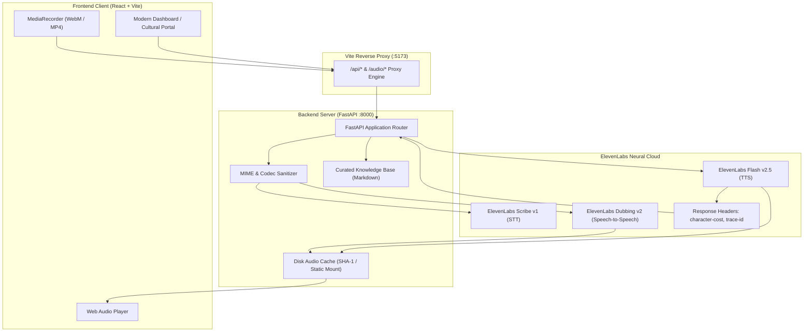

# 🏛️ Yatra Saathi (यात्रा साथी)
### *Next-Generation Multimodal Voice Companion & Live Heritage Interpreter*

[](https://fastapi.tiangolo.com)
[](https://react.dev)
[](https://vitejs.dev)
[](https://elevenlabs.io)
[](https://opensource.org/licenses/MIT)

**Yatra Saathi** (*Travel Companion* in Hindi) is a voice-first, bilingual artificial intelligence guide and real-time speech interpreter designed to make cultural heritage accessible, evocative, and barrier-free. Focused initially on the historic city of **Lucknow, India**, Yatra Saathi combines zero-latency narrative synthesis, grounded cultural knowledge retrieval, and cross-lingual speech-to-speech translation into a clean, modern interface.

---

## 🧭 Philosophical & Architectural Vision

Heritage tourism is inherently sensory, conversational, and grounded in oral tradition. Traditional audio guides are static, monotone, and bound to physical hardware. Yatra Saathi reimagines this experience as an intelligent conversational partner:

1. **Acoustic Fidelity & Emotion**: Rather than robotic text-to-speech, historical stories are rendered using ElevenLabs' neural voice models (`eleven_flash_v2_5`), preserving prosody, breath, and cadence in both English and natural spoken Devanagari Hindi.
2. **Pure Speech Translation**: Using ElevenLabs Dubbing v2 and Scribe v1, tourists and local artisans or guides can communicate bidirectionally across English and Hindi without requiring external cloud translation LLMs.
3. **Telemetry & Observability**: Every audio transaction transparently logs usage metrics directly extracted from HTTP response headers (`character-cost`, `request-id`, `x-trace-id`) onto an analytics dashboard.

---

## 🏗️ System Architecture



---

## ✨ Key Capabilities

### 1. 🏛️ Immersive AI Cultural Guide
- Instant vocal narration of Lucknow's most celebrated heritage landmarks:
  - **Bara Imambara** (*The pillarless architectural wonder & Bhul Bhulaiya*)
  - **Rumi Darwaza** (*The 60-foot iconic gateway of Awadh*)
  - **Tunday Kababi** (*Centuries-old culinary legacy of royal Galouti Kebabs*)
- Seamless bilingual toggle between **हिन्दी (Hindi)** and **English**.
- Smart disk caching ensures previously synthesized stories play instantaneously without redundant API consumption.

### 2. 🌐 Live Voice Interpreter (Pure ElevenLabs)
- Real-time speech translation allowing tourists and locals to speak naturally in their native tongues.
- **Source Audio Recognition**: Transcribes spoken sentences through ElevenLabs Scribe.
- **Cross-Lingual Dubbing**: Directly translates source audio into target language voice while maintaining natural tone and emotion.
- **Sub-Second Output**: Returns both written translated transcript and synthesized spoken audio simultaneously.

### 3. 🔍 Grounded Cultural Q&A
- Voice-driven questioning: tourists tap the microphone and ask historical inquiries (*e.g., "Why was Rumi Darwaza built?"*).
- Contextually restricted to verified historical facts from curated markdown knowledge bases to eliminate AI hallucinations.

### 4. 📊 Live Telemetry & Quota Observability
- Integrated dashboard tracking:
  - Total Text-to-Speech (TTS) calls
  - Total Speech-to-Text (STT) calls
  - Exact ElevenLabs character units consumed (`character-cost`)
  - Real-time request trace tokens (`request-id`, `x-trace-id`)

---

## 📁 Repository Structure

```
yatra-saathi/
├── backend/                  # FastAPI Application Core
│   ├── kb/                   # Curated Landmark Knowledge Bases
│   │   ├── bara_imambara.md
│   │   ├── rumi_darwaza.md
│   │   └── tunday_kababi.md
│   ├── cache/                # Disk cache for synthesized MP3s
│   ├── eleven.py             # ElevenLabs SDK, Header Telemetry & Dubbing
│   ├── llm.py                # Grounded Knowledge Engine & Translations
│   ├── main.py               # REST API endpoints & static file serving
│   ├── pregen.py             # Pre-caching batch script
│   ├── requirements.txt      # Python dependencies
│   ├── .env.example          # Environment variable template
│   └── README.md             # Backend architecture documentation
├── frontend/                 # React 18 + Vite Web Application
│   ├── public/
│   │   └── images/           # Landmark photography & visual assets
│   ├── src/
│   │   ├── hooks/            # Custom hooks (e.g. useRecorder)
│   │   ├── api.js            # Unified backend API client
│   │   ├── App.jsx           # Master shell & navigation layout
│   │   ├── Dashboard.jsx     # Telemetry & landmark exploration dashboard
│   │   ├── Guide.jsx         # Bilingual narration & heritage Q&A
│   │   ├── Interpreter.jsx   # Live cross-language speech interpreter
│   │   ├── MicButton.jsx     # Pulse-animated voice recording control
│   │   ├── styles.css        # Vanilla CSS design system & micro-interactions
│   │   └── main.jsx          # React entry point
│   ├── vite.config.js        # Vite build & reverse-proxy configuration
│   ├── package.json          # Node dependencies & build scripts
│   └── README.md             # Frontend architecture documentation
├── .gitignore                # Production git exclusion rules
└── README.md                 # Primary system manual
```

---

## 🚀 Quickstart Guide

### Prerequisites
- **Python 3.10+**
- **Node.js 18+** & `npm`
- An **[ElevenLabs](https://elevenlabs.io/)** account and API key.

---

### Step 1: Backend Setup

```bash
cd backend

# Create and activate virtual environment
python3 -m venv .venv
source .venv/bin/activate

# Install dependencies
pip install -r requirements.txt

# Configure your environment
cp .env.example .env
```

Open `backend/.env` and insert your credentials:
```env
ELEVENLABS_API_KEY=your_actual_elevenlabs_key_here
ELEVEN_VOICE_EN=21m00Tcm4TlvDq8ikWAM
ELEVEN_VOICE_HI=21m00Tcm4TlvDq8ikWAM
ELEVEN_TTS_MODEL=eleven_flash_v2_5
ELEVEN_STT_MODEL=scribe_v1
```

*(Optional: You may also add an OpenAI/Groq compatible `LLM_API_KEY` for freeform landmark Q&A, though narration and live interpretation run purely on ElevenLabs).*

Start the FastAPI server:
```bash
python3 -m uvicorn main:app --host 0.0.0.0 --port 8000 --reload
```
The backend API is now live at `http://localhost:8000` with interactive Swagger docs at `http://localhost:8000/docs`.

---

### Step 2: Frontend Setup

Open a new terminal session:
```bash
cd frontend

# Install frontend dependencies
npm install

# Launch Vite development server
npm run dev
```

Visit **`http://localhost:5173`** in your browser.

> [!TIP]
> **Mobile Microphone Access**: Modern mobile browsers enforce HTTPS to access microphone inputs (`navigator.mediaDevices.getUserMedia`). For on-device testing, expose the Vite server using a secure tunnel:
> ```bash
> npx cloudflared tunnel --url http://localhost:5173
> ```

---

## 📡 API Reference Summary

| Method | Endpoint | Description |
|---|---|---|
| `GET` | `/api/health` | Healthcheck and service configuration state. |
| `GET` | `/api/landmarks` | Retrieves curated metadata and imagery for all registered heritage sites. |
| `GET` | `/api/narrate/{id}?lang=en\|hi` | Synthesizes or retrieves cached bilingual audio narration for a landmark. |
| `POST` | `/api/ask` | Multipart audio upload for voice Q&A about a specific landmark. |
| `POST` | `/api/interpret` | Multipart audio upload for pure ElevenLabs speech-to-speech translation. |
| `GET` | `/api/stats` | Returns real-time ElevenLabs telemetry and character usage statistics. |
| `GET` | `/audio/{filename}` | Serves cached narration and translation MP3 audio files. |

---

## 🛡️ Security & Privacy Guardrails

- **Zero-Secret Commits**: Production `.gitignore` explicitly prevents `.env`, local audio caches, and intermediate recording files from being committed.
- **MIME Type Sanitization**: Automatically strips browser-specific codec parameters (e.g. `audio/mp4; codecs=mp4a.40.2`) to prevent validation failures on external voice APIs.
- **Dynamic Key Reloading**: Backend environment variables update dynamically via `load_dotenv(override=True)` without requiring process restarts or persistent disk logging of credentials.

---

## 📜 License

Distributed under the **MIT License**. See [LICENSE](LICENSE) for full details.

Developed with ❤️ for cultural preservation and seamless cross-lingual travel.
